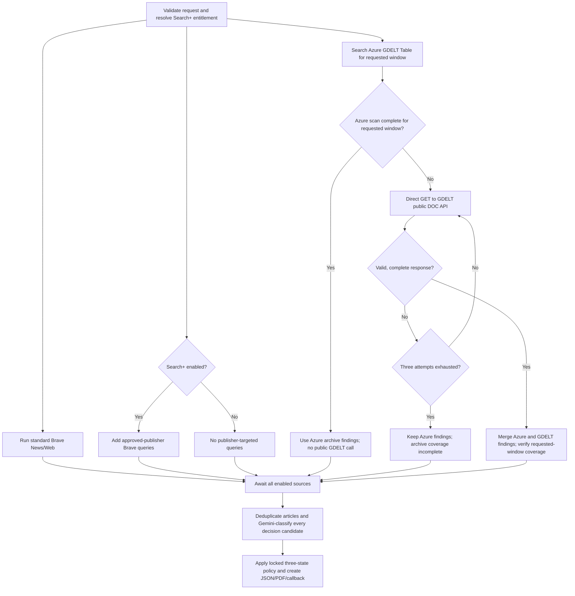

# Adverse Media: Azure-first archive, three-attempt GDELT fallback, Search+, and locked profile

**Base:** unreleased `codex/adverse-media-one-year-default` branch. This is the corrected implementation plan; no runtime behavior described below is claimed to be deployed.

## Decisions and why the earlier plan was wrong

The earlier plan omitted the public GDELT fallback and treated Search+ publisher searches as interchangeable with the base searches. That would leave avoidable archive gaps and could reduce base coverage when Search+ is on. The 19 November 2026 50-case benchmark used live Brave/Gemini but replayed Azure lookup snapshots into the local API route. It had **zero public GDELT calls**, because staged `infrastructure/api.bicep` sets `GDELT_PUBLIC_FALLBACK_ENABLED=false`. Twenty-five historical requests were therefore partial. The published CSV (16 completed) and later retained JSON/PDFs (20 completed) disagree for eight cases and cannot be used as one frozen quality result.

The user-confirmed product policy is:

- Run **Azure archive first**. Call the **public GDELT DOC endpoint only when Azure cannot cover the requested window** or its scan is incomplete. Do not call the public endpoint when Azure has complete coverage.
- Call **standard Brave news/web queries in both modes**. When Search+ is enabled, add approved-publisher queries; do not remove base queries to fit the current shared 12-query cap. Search+ off must make zero publisher-targeted calls.
- Before declaring the archive partial after a public GDELT failure, make **three direct public-GDELT HTTP attempts**. Await the attempts and their result before finalizing the entire API response. A success on attempt one or two ends the retry sequence.
- Gemini classifies each retrieved article as **Adverse**, **General News**, **No Impact**, or internally **Unresolved**. The only external profile values are `Safe`, `Unsafe`, `Inconclusive`.
- **Three or more confirmed adverse articles ⇒ Unsafe even if source coverage remains partial.** One or two confirmed adverse articles with complete coverage ⇒ Unsafe. Safe requires complete configured-source coverage, zero confirmed adverse articles, and zero genuinely unresolved potentially adverse articles. If coverage is incomplete after the three GDELT attempts and fewer than three adverse articles are confirmed, return Inconclusive. If coverage is complete but a potentially material article cannot genuinely be classified, return Inconclusive.

## Exact request workflow

**Public fallback means one component call, never recursive screening.** `lib/adverse-media.mjs` must call `https://api.gdeltproject.org/api/v2/doc/doc` directly through the existing fetch/rate-limit path. It must not POST to `/service/adverse_media`, call the whole KYCProbe API again, or repeat Brave/Gemini searches on each public-GDELT retry. Merge the successful public results once; classify the merged findings once.

The existing public request uses `timespan=1y`, `maxrecords=50`, two attempts and then claims `complete:true` on any HTTP success. Replace this. Send the **actual missing date window** using GDELT DOC `startdatetime`/`enddatetime` when the API supports that window; check status, content type, JSON schema, returned dates, result cap and any provider error text. Split a window or mark it incomplete if the result limit can hide matching articles. Record `azure_window`, `public_window`, `public_attempts`, `public_statuses`, `archive_covered_window`, and exact failure reason. A 200 response with an unverified window is not complete coverage. GDELT documents date parameters and a bounded ArtList size, but the currently supported historical horizon must be verified with controlled direct calls before claiming an older range is covered. [GDELT DOC API](https://blog.gdeltproject.org/gdelt-doc-2-0-api-debuts/), [one-year update](https://blog.gdeltproject.org/doc-geo-2-0-api-updates-full-year-searching-and-more/).

Use three bounded attempts for any failed or invalid public response, with the existing minimum spacing, exponential backoff, and `Retry-After` when supplied. Preserve partial Azure results on final failure. The API must await `Promise.allSettled` of standard Brave, conditional publisher searches, and the completed archive fallback before Gemini and report finalization. Verify the worst-case three-attempt path plus Gemini/PDF fits Azure Container Apps' **240-second HTTP request timeout**; reduce per-attempt timeouts within that total rather than returning partial after two attempts. If the full path cannot fit, change the endpoint to a documented asynchronous final-result contract before release rather than silently timing out. [Azure Container Apps ingress](https://learn.microsoft.com/en-us/azure/container-apps/ingress).

## Search+ on/off contract

- **Off:** same standard Brave plan and Azure-first archive path; no publisher queries or publisher-coverage claim.
- **On:** same standard plan **plus** selected approved-publisher `site:` Brave Web batches. Preserve selected, attempted, completed, failed **and skipped** domains (with skip reason), queries, batches, and article-level publisher matches in the response. The current planner allows up to six publisher batches, up to ten domains per batch, and a 400-character query; those limits can skip domains. Continue using the existing approved-publisher catalog; do not claim every publisher in it was searched when only a subset was selected.
- The current planner has a 12-paid-query **shared** budget and allocates publisher batches before trimming standard queries (`lib/adverse-media.mjs`, `remainingQueryBudget` / `standardQueryBudget`). Give base and publisher work separate explicit budgets. Check the existing $0.14 provider reservation guard before spending; if the enabled scope cannot fit, fail with a truthful reason instead of silently omitting base or promised publisher queries. Verify both the dedicated Search+ endpoint and any `search_plus:true` request use the same entitlement, mode and Gemini path, with no bypass or silent downgrade.

## Locked profile and coverage contract

Keep API enum values lowercase (`safe|unsafe|inconclusive`) and display exactly `Safe|Unsafe|Inconclusive` in the PDF/UI. The **server applies the fixed count-and-coverage policy to Gemini-classified articles**; Gemini supplies the adverseness, subject relation, category and cited evidence for each article. It also writes the human-readable rationale, but cannot override the locked policy. Count distinct verified articles after canonical URL/content deduplication; syndicated duplicates and repeated index hits must not inflate the three-article threshold. A high keyword score or exact-name match alone is not a confirmed adverse article.

| Confirmed adverse articles | Source coverage | Unresolved potentially adverse articles | Profile | API status | Decision eligible |
| ---: | --- | --- | --- | --- | --- |
| 3+ | Complete or partial | Any | `unsafe` | `completed` if complete, else `partial` | Only if complete; otherwise manual review |
| 1–2 | Complete | Any | `unsafe` | `completed` | Yes, with human review |
| 1–2 | Partial after fallback | Any | `inconclusive` | `partial` | No; show adverse leads |
| 0 | Complete | 0 | `safe` | `completed` | Yes |
| 0 | Complete | 1+ genuinely unresolved | `inconclusive` | `completed` | No; cite the unresolved items |
| 0 | Partial after fallback | Any | `inconclusive` | `partial` | No; name the failed source/window |

`coverage.complete` describes **configured source/window execution**, not Gemini certainty or universal coverage of the internet. If it is `true`, `status` cannot be `partial`: every required standard query, selected Search+ publisher batch (when enabled), and the Azure or verified public archive window must have finished without a scan/result cap. Gemini uncertainty belongs under `adjudication`, not `coverage`. If it is `false`, `Safe` is forbidden. `Unsafe` is still returned for three or more confirmed articles, with `decision_eligible=false` and the missing coverage prominently displayed. Keep source failures and profile evidence separate in JSON, callback, Flo and PDF. A completed-result cache may only reuse an exact normalized request with the same Search+ mode, source-window receipt and model/prompt version; an archive watermark change or expired cache must trigger fresh source checks. Do not silently turn a cached historical result into a new Safe claim.

The present per-item Gemini paths see only titles/excerpts. For potential adverse evidence, use available publisher text or a verifiable source excerpt and event date before confirming the article; classify a targeted company as **victim**, and avoid treating an updated historical compilation page as a new adverse event. Keep every candidate's evidence ID, source, article date, subject relation, classification and uncertainty reason. The final public profile must never be calculated again from risk-score thresholds or PDF display logic. Treat article text as untrusted; use strict Gemini JSON schemas and reject unsupported IDs, missing item dispositions, and instructions embedded in articles.

## Implementation steps and files

| Step | Update existing files | Create files | Work and acceptance |
| --- | --- | --- | --- |
| 1. Restore and harden archive fallback | `lib/adverse-media.mjs`, `lib/gdelt-local-index.mjs`, `infrastructure/api.bicep` | `lib/adverse-media-coverage.mjs` | Remove the staged blanket `GDELT_PUBLIC_FALLBACK_ENABLED=false` deployment setting. Azure first; direct public DOC only for Azure gaps; exactly three failed attempts before partial. Never mark a truncated/unsupported/incorrect-date public response complete. Preserve Azure results and full attempt telemetry. |
| 2. Make Search+ truly additive | `lib/adverse-media.mjs`, `lib/approved-publishers.mjs`, `lib/screening-cost-guard.mjs`, `server.mjs` | None | Off/on entitlement and query manifest; on includes every base query plus the selected publisher batches. No base query is removed for publisher budget. Measure cost/headroom and selected domains. |
| 3. Classify articles and apply profile rules | `lib/adverse-media.mjs`, `lib/ai7uae-gemini-adverse-api.mjs`, `lib/ai7uae-gpt-guidelines.mjs`, `lib/ai7uae-gpt-party-facts.mjs` | `lib/adverse-media-profile-decision.mjs` | Classify every decision candidate before applying display `max_results`. Deduplicate, distinguish direct adverse conduct from victims, and enforce the six-row policy table. Gemini outputs article labels and citations; server validates, counts and locks the profile. |
| 4. Keep response/report consumers aligned | `server.mjs`, `lib/adverse-media-report.mjs`, `lib/adverse-media-report-pdf.mjs`, `lib/flows/checks.mjs`, `api-site/adverse-media.js`, `api-site/adverse-media.html`, `api-site/adverse-media-coverage.html` | None | Replace the Search+ early `SEARCH_INCOMPLETE` 503 with a final partial/Inconclusive response after the archive attempts when some sources succeeded; reserve 503 for a screening that cannot run. JSON, PDF, callback, demo UI and Flo display the same three-value profile and separate source coverage. Retain `decision_eligible=false` when an Unsafe profile has partial coverage or any profile is Inconclusive. Audit clients that assume `status=completed` alone means clearance; version the contract if needed. |
| 5. Verify and reconcile | `test/adverse-media.test.mjs`, `test/adverse-media-public-coverage.test.mjs`, `test/adverse-media-archive-full-api.test.mjs`, `test/adverse-media-search-plus-planner.test.mjs`, `test/adverse-media-search-plus-api.test.mjs`, `test/adverse-media-adjudication.test.mjs`, `test/adverse-media-report.test.mjs`, `test/forms.test.mjs`, `test/flo-supplier-onboarding-report.test.mjs` | `test/adverse-media-profile-decision.test.mjs`, `test/fixtures/adverse-media-profile-gold.json`, `docs/adverse-media-profile-qa.md` | Add deterministic three-attempt/wait tests, direct-URL spy, additive Search+ comparison, six-row policy matrix, victim/old-page holdout, and JSON/PDF consistency checks. Preserve the earlier 50-case record and produce one new immutable per-case manifest with matching response/report hashes. |

No new cloud service or secret is needed for these rules. The existing Azure archive still contains only about 27 days; backfill must be completed separately before advertising a full year of Azure coverage. Do not edit its watermark without the corresponding files and indexed rows.

## Release gates

1. Unit and HTTP tests prove: Azure complete ⇒ zero public GDELT calls; Azure incomplete ⇒ direct DOC calls with attempt count 1, 2, 3 as required; no partial finalization before attempt 3 on repeated failure; result from attempt 3 is accepted; public failure keeps Azure findings; no recursive `/service/adverse_media` call.
2. Search+ off and on receive the same base query list and archive logic; on adds publisher queries and lists the actual domains. No missing publisher batch or base query can be called complete. Measure the increased Brave/Gemini cost against the existing guardrail.
3. Human-labelled examples prove the policy matrix, especially 3+ adverse with partial coverage ⇒ Unsafe; zero adverse with all enabled mechanisms complete ⇒ Safe; genuine ambiguity or failed coverage ⇒ Inconclusive. ADNOC attacked-vessel and old Saudi Aramco compilation cannot be marked Unsafe solely from those snippets. No covered case may have `status=partial`.
4. Rerun an authenticated controlled cohort through the actual deployed candidate revision with live Azure reads, real direct public-GDELT fallback, Search+ both ways, and one frozen request/attempt/Gemini/JSON/PDF manifest per case. Reconcile every count and report label. Keep the existing production revision serving traffic until this passes.
